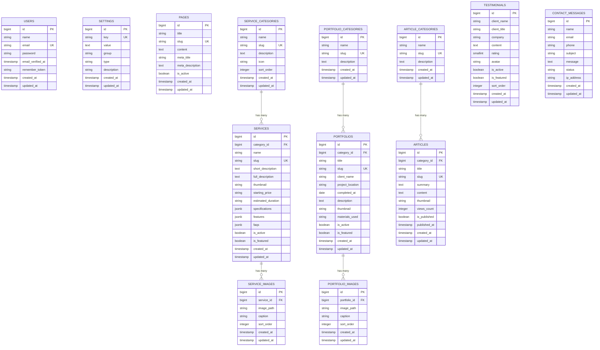

# AzkaMandiri – Database Design & Schema Specification

Dokumen ini mendokumentasikan rancangan basis data relasional **MySQL 8.0+ (InnoDB)** untuk aplikasi **AzkaMandiri**, mencakup Entity Relationship Diagram (ERD), skema kamus data per tabel, konfigurasi relasi integritas referensial (foreign keys & cascading), serta strategi indexing performa tinggi.

---

## 1. Entity Relationship Diagram (ERD)

---

## 2. Kamus Data & Spesifikasi Tabel

### 2.1. Tabel `users`
Menyimpan data otentikasi administrator CMS.
| Kolom | Tipe Data MySQL | Nullable | Default | Keterangan |
|:---|:---|:---|:---|:---|
| `id` | `bigserial` | NO | auto | Primary Key |
| `name` | `varchar(255)` | NO | - | Nama lengkap admin |
| `email` | `varchar(255)` | NO | - | Email login (Unique Index) |
| `password` | `varchar(255)` | NO | - | Hash bcrypt kata sandi |
| `email_verified_at` | `timestamp` | YES | `NULL` | Waktu verifikasi email |
| `remember_token` | `varchar(100)` | YES | `NULL` | Token "ingat saya" |
| `created_at` | `timestamp` | YES | `NULL` | Timestamp pembuatan |
| `updated_at` | `timestamp` | YES | `NULL` | Timestamp pembaruan |

---

### 2.2. Tabel `settings`
Menyimpan konfigurasi profil website, kontak bisnis, dan konfigurasi SEO secara dinamis berbasis pasangan key-value.
| Kolom | Tipe Data MySQL | Nullable | Default | Keterangan |
|:---|:---|:---|:---|:---|
| `id` | `bigserial` | NO | auto | Primary Key |
| `key` | `varchar(255)` | NO | - | Unique identifier setting (misal: `site_name`, `whatsapp_number`) |
| `value` | `text` | YES | `NULL` | Nilai konfigurasi |
| `group` | `varchar(50)` | NO | `'general'` | Pengelompokan: `general`, `contact`, `social`, `seo` |
| `type` | `varchar(20)` | NO | `'text'` | Tipe input: `text`, `textarea`, `image`, `json` |
| `description` | `varchar(255)` | YES | `NULL` | Penjelasan label setting |
| `created_at` | `timestamp` | YES | `NULL` | Timestamp pembuatan |
| `updated_at` | `timestamp` | YES | `NULL` | Timestamp pembaruan |

---

### 2.3. Tabel `pages`
Menyimpan konten halaman statis dinamis (Syarat & Ketentuan, Kebijakan Privasi, Garansi).
| Kolom | Tipe Data MySQL | Nullable | Default | Keterangan |
|:---|:---|:---|:---|:---|
| `id` | `bigserial` | NO | auto | Primary Key |
| `title` | `varchar(255)` | NO | - | Judul halaman |
| `slug` | `varchar(255)` | NO | - | URL slug unik (Unique Index) |
| `content` | `text` | NO | - | Isi halaman lengkap (format HTML/Text) |
| `meta_title` | `varchar(255)` | YES | `NULL` | Custom SEO Title |
| `meta_description`| `text` | YES | `NULL` | Custom SEO Description |
| `is_active` | `boolean` | NO | `true` | Status publikasi |
| `created_at` | `timestamp` | YES | `NULL` | Timestamp pembuatan |
| `updated_at` | `timestamp` | YES | `NULL` | Timestamp pembaruan |

---

### 2.4. Tabel `service_categories`
Kategori pengelompokan layanan pengerjaan aluminium & kaca.
| Kolom | Tipe Data MySQL | Nullable | Default | Keterangan |
|:---|:---|:---|:---|:---|
| `id` | `bigserial` | NO | auto | Primary Key |
| `name` | `varchar(255)` | NO | - | Nama kategori |
| `slug` | `varchar(255)` | NO | - | URL slug unik |
| `description` | `text` | YES | `NULL` | Deskripsi singkat kategori |
| `icon` | `varchar(100)` | YES | `NULL` | Nama icon visual Lucide |
| `sort_order` | `integer` | NO | `0` | Urutan penayangan |
| `created_at` | `timestamp` | YES | `NULL` | Timestamp pembuatan |
| `updated_at` | `timestamp` | YES | `NULL` | Timestamp pembaruan |

---

### 2.5. Tabel `services`
Daftar seluruh produk dan jasa pengerjaan aluminium & kaca.
| Kolom | Tipe Data MySQL | Nullable | Default | Keterangan |
|:---|:---|:---|:---|:---|
| `id` | `bigserial` | NO | auto | Primary Key |
| `category_id` | `bigint` | NO | - | Foreign Key ke `service_categories.id` (Cascade On Delete) |
| `name` | `varchar(255)` | NO | - | Nama layanan (misal: *Kusen Aluminium Profil 3" & 4"*) |
| `slug` | `varchar(255)` | NO | - | URL slug unik |
| `short_description`| `text` | NO | - | Ringkasan singkat untuk kartu preview |
| `full_description` | `text` | NO | - | Rincian lengkap layanan |
| `thumbnail` | `varchar(255)` | YES | `NULL` | Berkas gambar cover utama |
| `starting_price` | `varchar(100)` | YES | `NULL` | Estimasi harga mulai (misal: *Rp 120.000 / m'*) |
| `estimated_duration`| `varchar(100)`| YES | `NULL` | Estimasi waktu fabrikasi & instalasi |
| `specifications` | `jsonb` | YES | `NULL` | Objek JSON spesifikasi teknis (merek, ketebalan, finishing) |
| `features` | `jsonb` | YES | `NULL` | Array JSON keunggulan layanan |
| `faqs` | `jsonb` | YES | `NULL` | Array JSON tanya-jawab spesifik layanan |
| `is_active` | `boolean` | NO | `true` | Status tampil di katalog |
| `is_featured` | `boolean` | NO | `false` | Highlight di section Beranda |
| `created_at` | `timestamp` | YES | `NULL` | Timestamp pembuatan |
| `updated_at` | `timestamp` | YES | `NULL` | Timestamp pembaruan |

---

### 2.6. Tabel `service_images`
Menyimpan multi-gambar galeri dokumentasi pengerjaan layanan.
| Kolom | Tipe Data MySQL | Nullable | Default | Keterangan |
|:---|:---|:---|:---|:---|
| `id` | `bigserial` | NO | auto | Primary Key |
| `service_id` | `bigint` | NO | - | Foreign Key ke `services.id` (Cascade On Delete) |
| `image_path` | `varchar(255)` | NO | - | Lokasi path file pada disk publik |
| `caption` | `varchar(255)` | YES | `NULL` | Keterangan foto |
| `sort_order` | `integer` | NO | `0` | Urutan foto galeri |
| `created_at` | `timestamp` | YES | `NULL` | Timestamp pembuatan |
| `updated_at` | `timestamp` | YES | `NULL` | Timestamp pembaruan |

---

### 2.7. Tabel `portfolio_categories`
Kategori pengelompokan portofolio (Residential, Commercial, Interior).
| Kolom | Tipe Data MySQL | Nullable | Default | Keterangan |
|:---|:---|:---|:---|:---|
| `id` | `bigserial` | NO | auto | Primary Key |
| `name` | `varchar(255)` | NO | - | Nama kategori proyek |
| `slug` | `varchar(255)` | NO | - | URL slug unik |
| `description` | `text` | YES | `NULL` | Deskripsi kategori |
| `created_at` | `timestamp` | YES | `NULL` | Timestamp pembuatan |
| `updated_at` | `timestamp` | YES | `NULL` | Timestamp pembaruan |

---

### 2.8. Tabel `portfolios`
Showcase hasil pengerjaan proyek riil AzkaMandiri.
| Kolom | Tipe Data MySQL | Nullable | Default | Keterangan |
|:---|:---|:---|:---|:---|
| `id` | `bigserial` | NO | auto | Primary Key |
| `category_id` | `bigint` | NO | - | Foreign Key ke `portfolio_categories.id` (Cascade On Delete) |
| `title` | `varchar(255)` | NO | - | Judul proyek (misal: *Instalasi Curtain Wall Ruko Golden Boulevard*) |
| `slug` | `varchar(255)` | NO | - | URL slug unik |
| `client_name` | `varchar(255)` | YES | `NULL` | Klien atau tipe properti |
| `project_location`| `varchar(255)` | YES | `NULL` | Lokasi pengerjaan (contoh: *BSD City, Tangerang Selatan*) |
| `completed_at` | `date` | YES | `NULL` | Tanggal penyelesaian proyek |
| `description` | `text` | NO | - | Penjelasan kebutuhan & solusi pengerjaan |
| `thumbnail` | `varchar(255)` | YES | `NULL` | Cover gambar portofolio |
| `materials_used` | `varchar(255)` | YES | `NULL` | Rincian material terpasang |
| `is_active` | `boolean` | NO | `true` | Status tayang di website |
| `is_featured` | `boolean` | NO | `false` | Ditampilkan pada section Beranda |
| `created_at` | `timestamp` | YES | `NULL` | Timestamp pembuatan |
| `updated_at` | `timestamp` | YES | `NULL` | Timestamp pembaruan |

---

### 2.9. Tabel `portfolio_images`
Multi-foto galeri dokumentasi hasil akhir proyek.
| Kolom | Tipe Data MySQL | Nullable | Default | Keterangan |
|:---|:---|:---|:---|:---|
| `id` | `bigserial` | NO | auto | Primary Key |
| `portfolio_id` | `bigint` | NO | - | Foreign Key ke `portfolios.id` (Cascade On Delete) |
| `image_path` | `varchar(255)` | NO | - | Lokasi berkas gambar |
| `caption` | `varchar(255)` | YES | `NULL` | Deskripsi foto |
| `sort_order` | `integer` | NO | `0` | Urutan gambar |
| `created_at` | `timestamp` | YES | `NULL` | Timestamp pembuatan |
| `updated_at` | `timestamp` | YES | `NULL` | Timestamp pembaruan |

---

### 2.10. Tabel `article_categories`
Kategori pengelompokan artikel edukasi dan tips konstruksi.
| Kolom | Tipe Data MySQL | Nullable | Default | Keterangan |
|:---|:---|:---|:---|:---|
| `id` | `bigserial` | NO | auto | Primary Key |
| `name` | `varchar(255)` | NO | - | Nama kategori |
| `slug` | `varchar(255)` | NO | - | URL slug unik |
| `description` | `text` | YES | `NULL` | Deskripsi singkat |
| `created_at` | `timestamp` | YES | `NULL` | Timestamp pembuatan |
| `updated_at` | `timestamp` | YES | `NULL` | Timestamp pembaruan |

---

### 2.11. Tabel `articles`
Konten artikel edukasi, tips memilih profil, dan panduan perawatan kaca.
| Kolom | Tipe Data MySQL | Nullable | Default | Keterangan |
|:---|:---|:---|:---|:---|
| `id` | `bigserial` | NO | auto | Primary Key |
| `category_id` | `bigint` | NO | - | Foreign Key ke `article_categories.id` (Cascade On Delete) |
| `title` | `varchar(255)` | NO | - | Judul artikel |
| `slug` | `varchar(255)` | NO | - | URL slug unik |
| `summary` | `text` | NO | - | Ringkasan artikel untuk preview card |
| `content` | `text` | NO | - | Konten artikel lengkap |
| `thumbnail` | `varchar(255)` | YES | `NULL` | Cover gambar artikel |
| `views_count` | `integer` | NO | `0` | Counter jumlah pembaca (auto-increment) |
| `is_published` | `boolean` | NO | `true` | Status publikasi |
| `published_at` | `timestamp` | YES | `NULL` | Tanggal & waktu publikasi resmi |
| `created_at` | `timestamp` | YES | `NULL` | Timestamp pembuatan |
| `updated_at` | `timestamp` | YES | `NULL` | Timestamp pembaruan |

---

### 2.12. Tabel `testimonials`
Ulasan kepuasan dari klien pemilik rumah, arsitek, dan kontraktor.
| Kolom | Tipe Data MySQL | Nullable | Default | Keterangan |
|:---|:---|:---|:---|:---|
| `id` | `bigserial` | NO | auto | Primary Key |
| `client_name` | `varchar(255)` | NO | - | Nama klien / pemilik properti |
| `client_title`| `varchar(255)` | YES | `NULL` | Profesi / jenis properti |
| `company` | `varchar(255)` | YES | `NULL` | Asosiasi usaha / residensial |
| `content` | `text` | NO | - | Isi testimoni ulasan |
| `rating` | `smallint` | NO | `5` | Nilai rating 1 sampai 5 bintang |
| `avatar` | `varchar(255)` | YES | `NULL` | Foto avatar klien |
| `is_active` | `boolean` | NO | `true` | Status tampil di web |
| `is_featured` | `boolean` | NO | `true` | Ditampilkan di Beranda |
| `sort_order` | `integer` | NO | `0` | Urutan penayangan |
| `created_at` | `timestamp` | YES | `NULL` | Timestamp pembuatan |
| `updated_at` | `timestamp` | YES | `NULL` | Timestamp pembaruan |

---

### 2.13. Tabel `contact_messages`
Menampung seluruh pesan masuk dari calon pelanggan melalui form kontak publik.
| Kolom | Tipe Data MySQL | Nullable | Default | Keterangan |
|:---|:---|:---|:---|:---|
| `id` | `bigserial` | NO | auto | Primary Key |
| `name` | `varchar(255)` | NO | - | Nama pengirim |
| `email` | `varchar(255)` | NO | - | Email pengirim |
| `phone` | `varchar(50)` | NO | - | Nomor WhatsApp / HP pengirim |
| `subject` | `varchar(255)` | NO | - | Subjek konsultasi / permohonan survei |
| `message` | `text` | NO | - | Rincian pesan |
| `status` | `varchar(20)` | NO | `'unread'` | Status pesan: `unread`, `read`, `replied` |
| `ip_address` | `varchar(45)` | YES | `NULL` | IP address pengirim untuk audit |
| `created_at` | `timestamp` | YES | `NULL` | Timestamp pengiriman |
| `updated_at` | `timestamp` | YES | `NULL` | Timestamp pembaruan status |

---

## 3. Strategi Indexing & Integritas Relasi

1. **Integritas Referensial**:
   - Seluruh relasi anak (galeri gambar, tabel services, portfolios, articles) menggunakan `ON DELETE CASCADE` sehingga ketika sebuah kategori atau entitas induk dihapus oleh admin, relasi turunannya dibersihkan otomatis tanpa meninggalkan data yatim (*orphan records*).
2. **Pencarian Cepat Berbasis Slug (Unique Indexes)**:
   - Kolom `slug` pada tabel `pages`, `service_categories`, `services`, `portfolio_categories`, `portfolios`, `article_categories`, dan `articles` didefinisikan dengan indeks `UNIQUE`. Hal ini menjamin routing frontend `/{slug}` beroperasi dengan kompleksitas waktu $O(1)$.
3. **Optimasi Filter Status & Tampilan**:
   - Query publik selalu menyaring kolom `is_active = true` atau `is_published = true`, digabungkan dengan `is_featured = true` untuk halaman beranda.
4. **Pemanfaatan Tipe Data & Engine Asli MySQL 8.0+**:
   - Seluruh tabel menggunakan storage engine **InnoDB** dengan `ROW_FORMAT=DYNAMIC`, charset `utf8mb4`, dan collation `utf8mb4_unicode_ci`.
   - Kolom `features`, spesifikasi, dan JSON diproses menggunakan JSON/Text cast Laravel yang mendukung fleksibilitas data tinggi tanpa overhead join yang rumit.

